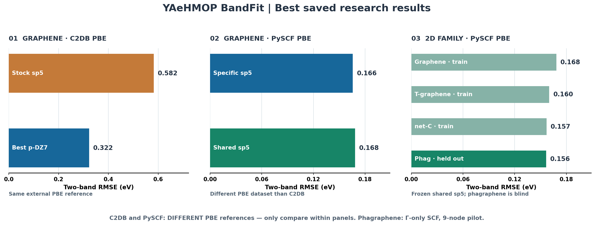

# YAeHMOP BandFit

**See the best graphene fits and carbon-band examples in one command.**

[](https://github.com/tromer-unb/yaehmop-bandfit/actions/workflows/tests.yml)
[Installation](docs/INSTALLATION.md) · [Best results](docs/BEST_RESULTS.md) · [Image/CSV input](docs/IMAGE_INPUT.md) · [All flags](docs/CLI_REFERENCE.md)

## Start here — 1 command, no heavy calculations

```bash
git clone https://github.com/tromer-unb/yaehmop-bandfit.git
cd yaehmop-bandfit
python3 -m pip install -r requirements.txt
python3 quick.py
```

That's it. The command displays the **best saved results**, plots real archived YAeHMOP bands for graphene, phagraphene, diamond and graphite, and demonstrates conversion of a regular PNG into the exact input format. **No DFT, no parameter fitting, no YAeHMOP binary required.** Output: `outputs/quick/`.



**Key results — two selected frontier bands (RMSE in eV):**

| Example | Model | RMSE | Run instantly |
|---|---|---:|---|
| **Graphene, C2DB PBE — best fit** | **True 2p double-zeta p-DZ7** | **0.3223** | `python3 quick.py graphene` |
| Graphene, C2DB PBE — baseline | Original single-zeta sp5 | 0.5823 | `python3 quick.py best` |
| **Graphene, PySCF PBE — best individual fit** | sp5, trained on graphene | **0.1657** | `python3 quick.py best` |
| Graphene, PySCF PBE — shared fit | sp5, trained on 3 carbon systems | 0.1683 | `python3 quick.py transfer` |
| **Phagraphene, PySCF PBE — blind transfer** | **Same frozen shared sp5** | **0.1564** | `python3 quick.py transfer` |

**Important:** C2DB and PySCF are **different PBE reference datasets**; their errors must not be compared as though they shared the same target. Phagraphene is a **Gamma-only SCF / 9-k-point pilot**, not a converged Dirac-cone demonstration. Values are from archived research data; the quick examples plot EHT predictions **without bundling external PBE bands**. The true p-DZ7 graphene fit used an **optional native YAeHMOP patch**, not stock YAeHMOP.

## Pick an example

| Command | What you immediately get |
|---|---|
| `python3 quick.py` | **Everything**: best-results dashboard, graphene, transfer, 3 carbon spectra, PNG converter |
| `python3 quick.py best` | **Best tested RMSE comparisons**, clearly grouped by PBE source |
| `python3 quick.py graphene` | **Best C2DB-fitted graphene p-DZ7**: saved valence/conduction EHT spectrum |
| `python3 quick.py transfer` | **Shared parameters**: graphene training vs held-out phagraphene |
| `python3 quick.py carbon` | Individual EHT bands: **graphene / diamond / AB graphite** |
| `python3 quick.py image` | A real color PNG converted to `bands_2_layers.png` with QA and preview |

Every example above runs **offline and without a solver**. For complete saved model parameters and numerical provenance, see [Best Results](docs/BEST_RESULTS.md).

## Your own PNG or numeric bands — just two steps

**1. Convert your reference.** Use CSV if you have numerical band energies; use `--mode colors` to trace visible curves from PNG/JPEG/TIFF/WebP etc.:

```bash
# Exact numeric bands — safest:
python3 USER_WORKFLOW/prepare_band_png.py examples/synthetic/toy_2bands.csv \
  --n-pairs 1 --emin -3.5 --emax 3.5 --mode csv --outdir outputs/reference

# Or regular PNG:
python3 quick.py image
```

**2. Inspect** `extraction_preview.png`, `extraction_qa.json` and `bands_2_layers.png` before fitting. The internal format is an 8-bit **band-bitplane PNG**, with a separate pixel bit for each of **2, 4, 6 or 8** bands. It preserves encoded crossings but **cannot recover hidden bands** from a screenshot. See [complete image guide](docs/IMAGE_INPUT.md) or [direct CSV guide](docs/NUMERIC_BANDS.md).

## Optional: fit your own material using YAeHMOP

Actual fitting is **separate**, requires a locally installed [original YAeHMOP](https://github.com/greglandrum/yaehmop) `bind` binary and an authorized atomic parameter file, and is **never launched by GitHub Actions**.

```bash
export YAEHMOP_BIND=/absolute/path/to/bind
export YAEHMOP_PARAM_FILE=/absolute/path/to/eht_parms.dat

python3 USER_WORKFLOW/bands_fit.py material.cif config.ini \
  --image your_bands.csv --mode csv --pairs 2 \
  --budget 300 --outdir outputs/my_fit
```

`--pairs 1,2,3,4` means **1V+1C / 2V+2C / 3V+3C / 4V+4C**, respectively. The real YAeHMOP Hamiltonian still computes all orbitals; only selected bands are calibrated. Gapless systems such as ideal graphene need a distinct objective; use the archived examples or carbon-specific research workflow, not a fabricated gap.

**Guides:** [Install YAeHMOP](docs/INSTALLATION.md) · [All CLI options](docs/CLI_REFERENCE.md) · [More examples](docs/EXAMPLES.md) · [Troubleshooting](docs/TROUBLESHOOTING.md) · [Scientific limitations](docs/SCIENTIFIC_SCOPE.md) · [Optional experimental p-DZ7 patch](experimental/README.md).

**License:** MIT for this frontend; upstream YAeHMOP and original scientific datasets retain their own licenses. The repository ships small archived EHT predictions and original toy fixtures, **not third-party DFT reference arrays or the native YAeHMOP executable**.
