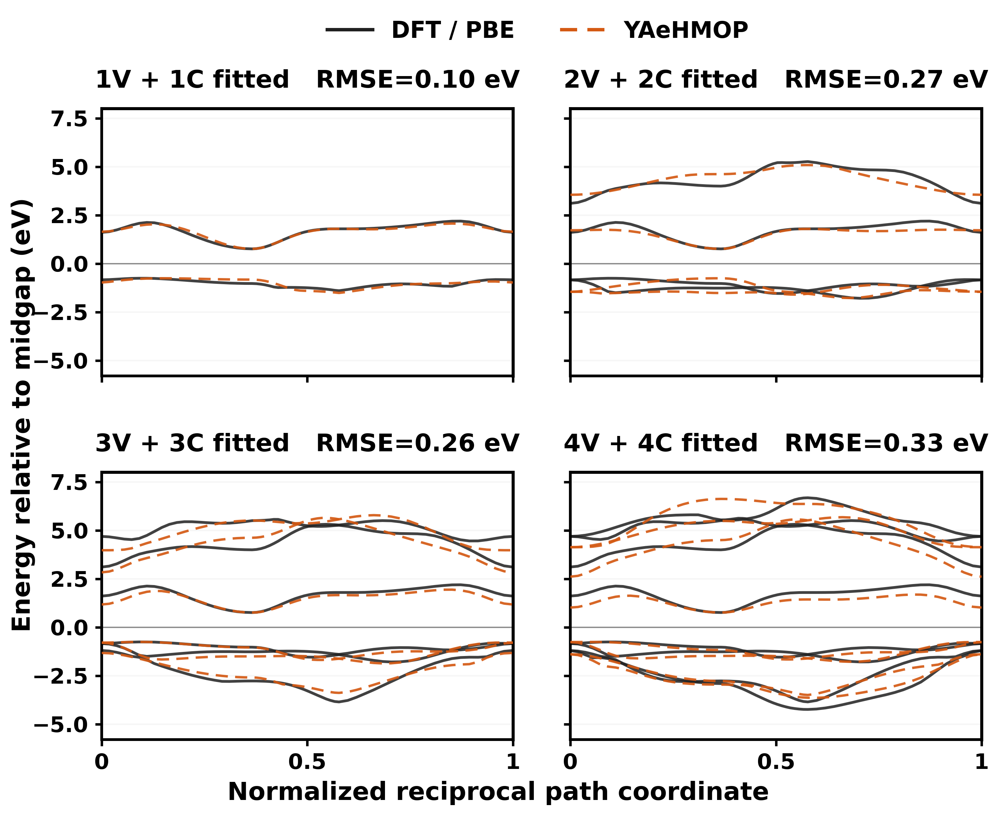
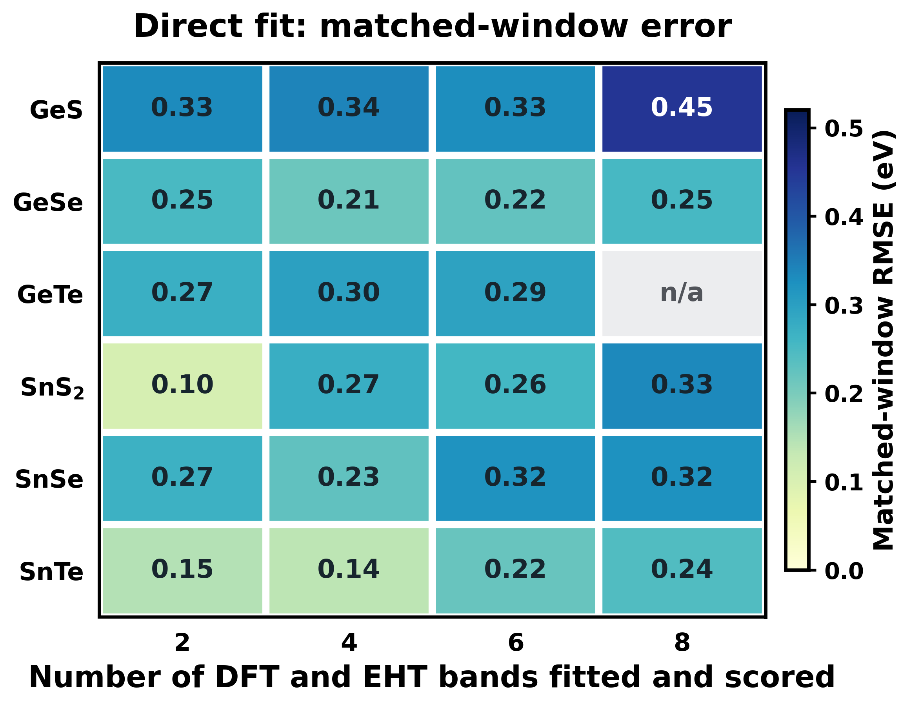

# YAeHMOP BandFit

**Fit and visualize electronic bands with physical extended Hückel theory — 2, 4, 6 or 8 bands.**

[](https://github.com/tromer-unb/yaehmop-bandfit/actions/workflows/tests.yml)
[Quick examples](#quick-start) · [SnS₂ / paper Fig. 4](#featured-example-sns₂--paper-figure-4) · [All six compounds](docs/CHALCOGENIDES.md) · [Carbon extension](docs/BEST_RESULTS.md) · [Image and CSV input](docs/IMAGE_INPUT.md) · [All CLI flags](docs/CLI_REFERENCE.md)

The **original study** evaluates **six Ge/Sn chalcogenides** — **GeS, GeSe, GeTe, SnS₂, SnSe and SnTe** — with exactly matched **1V+1C, 2V+2C, 3V+3C and 4V+4C** reference/model windows. It also measures chemical leave-one-system-out transferability. **Graphene, phagraphene, diamond and graphite are later carbon extensions**, not the entire scope of this work.

## Quick start

```bash
git clone https://github.com/tromer-unb/yaehmop-bandfit.git
cd yaehmop-bandfit
python3 -m pip install -r requirements.txt
python3 quick.py
```

**That is all you need to see the paper examples.** The command generates saved-band figures, the SnS₂ comparison, six-material summaries, carbon-extension plots, and a PNG-to-bands demonstration in `outputs/quick/`. **No YAeHMOP solver, DFT calculation, optimizer, network download or huge dataset required.**

## Featured example: SnS₂ — paper Figure 4

**Run only the SnS₂ examples:**

```bash
python3 quick.py sns2
```



**Fig. 4 is the central matched-window demonstration:** it compares original PBE and the corresponding physical YAeHMOP direct-fit bands for the *same number of states* in each panel.

| SnS₂ fit | Selected states | Direct-fit RMSE |
|---|---|---:|
| **2 bands** | **1 valence + 1 conduction** | **0.1043 eV** |
| 4 bands | 2 valence + 2 conduction | 0.2725 eV |
| 6 bands | 3 valence + 3 conduction | 0.2561 eV |
| 8 bands | 4 valence + 4 conduction | 0.3333 eV |

The quick command includes a copy of the **paper's PBE/EHT overlay figure** and generates `SnS2_2_4_6_8_eht.png` from archived, individual physical EHT energy CSVs. External original PBE arrays are **not redistributed**, and nothing is refitted during quick mode.

## Main paper: six chalcogenides, 2/4/6/8 bands

```bash
python3 quick.py materials          # GeS, GeSe, GeTe, SnS2, SnSe, SnTe
python3 quick.py chemical-transfer  # GENUINE leave-one-compound-out results
python3 quick.py SnTe               # An individual material, all fitted windows
python3 quick.py GeSe               # Or GeS, GeTe, SnSe, SnS2
```



| Window | Mean direct-fit RMSE | Materials | Mean zero-shot chemical-transfer RMSE | Eligible holdouts |
|---|---:|---:|---:|---:|
| **2 bands (1V+1C)** | **0.229 eV** | 6 | 0.807 eV | 6 |
| **4 bands (2V+2C)** | **0.248 eV** | 6 | 0.909 eV | 6 |
| **6 bands (3V+3C)** | **0.273 eV** | 6 | 0.704 eV | 6 |
| **8 bands (4V+4C)** | **0.321 eV** | 5 | 3.416 eV | 4 |

For every window, **N selected DFT bands are fitted to N selected YAeHMOP eigenvalues**; these are not post hoc eight-band errors from a two-band fit. The **8-band GeTe** direct fit was not eligible. Whole-compound held-out results are a different task from fitting the material itself, and their errors must not be combined with training errors.

The best individual direct fits across the six materials: **SnS₂** for 2 bands (**0.1043 eV**); **SnTe** for 4 (**0.1391 eV**), 6 (**0.2191 eV**) and 8 (**0.2433 eV**) bands. See [all per-material results and saved numerical bands](docs/CHALCOGENIDES.md).

## Try an individual material immediately

```bash
python3 quick.py GeS
python3 quick.py GeSe
python3 quick.py GeTe
python3 quick.py sns2
python3 quick.py SnSe
python3 quick.py SnTe
```

The repository ships **23 individual fitted physical EHT spectra**, one for each eligible material/window combination, in `examples/chalcogenides/<material>/<2|4|6|8>bands_eht.csv`. The quick command plots them immediately. These are saved **model outputs**, not externally downloaded PBE bands.

## Later extension: carbon allotropes

```bash
python3 quick.py best             # Original Ge/Sn study FIRST, then carbon scores
python3 quick.py graphene         # Best individual C2DB-PBE graphene fit, p-DZ7
python3 quick.py transfer         # Shared graphene sp5 -> held-out phagraphene
python3 quick.py carbon           # Saved EHT graphene, diamond, AB graphite
```


The extended study includes external C2DB graphene PBE (best patched p-DZ7 two-band RMSE **0.3223 eV**, vs stock sp5 **0.5823 eV**); separately generated PySCF/GTH-SZV PBE graphene (specific sp5 **0.1657 eV**, shared sp5 **0.1683 eV**); and blind phagraphene under the same shared sp5 model (**0.1564 eV**, but only 9 k points and Gamma-only SCF). Diamond and AB graphite add 3D tests. **Do not pool different PBE sources or confuse a training fit with transfer.** See [carbon details](docs/BEST_RESULTS.md).

## Your own bands: PNG, JPEG, TIFF, WebP or numerical CSV

```bash
# See the converter immediately: normal color PNG -> native two-band bits
python3 quick.py image

# Preferred: numerical reference energies from CSV
python3 USER_WORKFLOW/prepare_band_png.py examples/synthetic/toy_4bands.csv \
  --n-pairs 2 --emin -3.5 --emax 3.5 --mode csv --outdir outputs/my_input

# Ordinary two-color raster, specifying the actual plot rectangle and colors
python3 USER_WORKFLOW/prepare_band_png.py examples/synthetic/toy_2bands.png \
  --n-pairs 1 --emin -3.5 --emax 3.5 --mode colors \
  --bbox 115,105,1210,820 --colors '#c82d37,#1c7ad5' \
  --outdir outputs/from_image
```

Every accepted raster is normalized to `normalized_source.png`, validated, and converted into the one downstream format: **`bands_N_layers.png`**, an 8-bit grayscale PNG with one bit per selected band. The tool also produces `extraction_preview.png`, numeric extracted curves and QA statistics. It cannot recover physically hidden bands from a screenshot. [Image guide](docs/IMAGE_INPUT.md) · [Numeric bands](docs/NUMERIC_BANDS.md).

## Actually fit a new crystal (optional, runs local YAeHMOP)

To optimize parameters you must separately install an authorized [YAeHMOP `bind` executable](https://github.com/greglandrum/yaehmop) and atomic table. No native binary or DFT dataset is bundled.

```bash
export YAEHMOP_BIND=/absolute/path/to/bind
export YAEHMOP_PARAM_FILE=/absolute/path/to/eht_parms.dat

python3 USER_WORKFLOW/bands_fit.py material.cif config.ini \
  --image your_bands.csv --mode csv --pairs 2 \
  --budget 300 --outdir outputs/my_fit
```

`--pairs 1/2/3/4` means exactly `1V+1C / 2V+2C / 3V+3C / 4V+4C`. No solver runs in the Quick Start, CI, or saved-band plotter. The original image-driven fitter assumes a positive gap; graphene's ideal Dirac crossing requires a different carbon-specific objective.

**More:** [Installation](docs/INSTALLATION.md) · [All CLI options](docs/CLI_REFERENCE.md) · [Full example catalog](docs/EXAMPLES.md) · [Scientific limitations](docs/SCIENTIFIC_SCOPE.md) · [Experimental p-DZ7 source patch](experimental/README.md) · [Contributing](CONTRIBUTING.md).

**License:** MIT for this frontend; upstream YAeHMOP and external PBE source data retain their own licenses. Saved physical EHT outputs and paper figures are provided for fast research review without third-party raw DFT redistributions.
