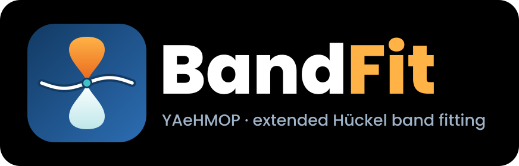
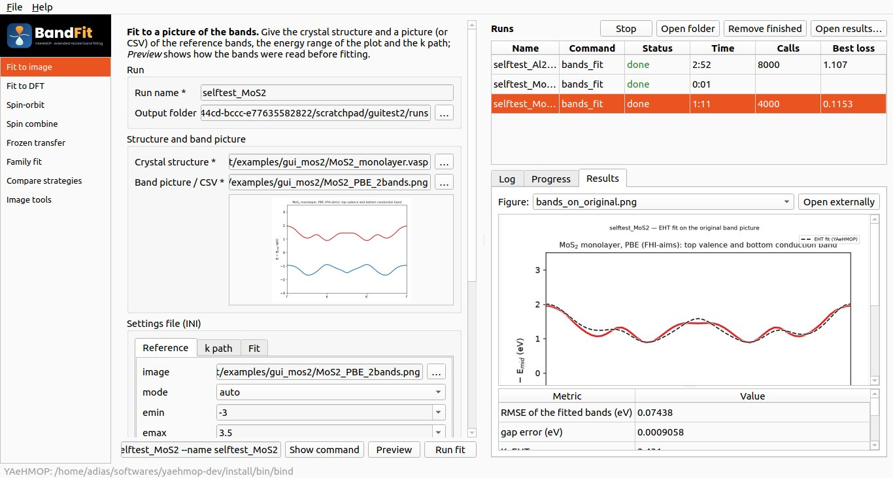
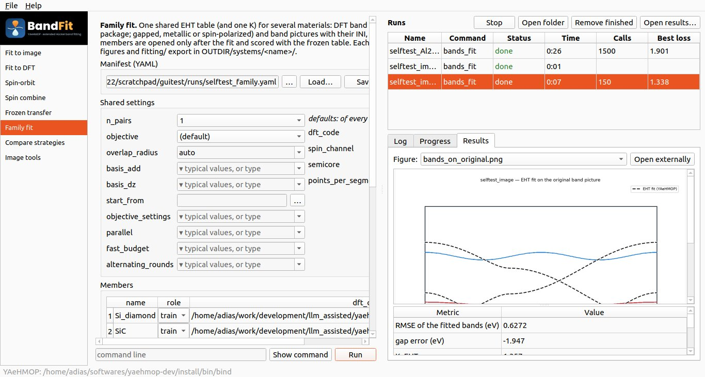
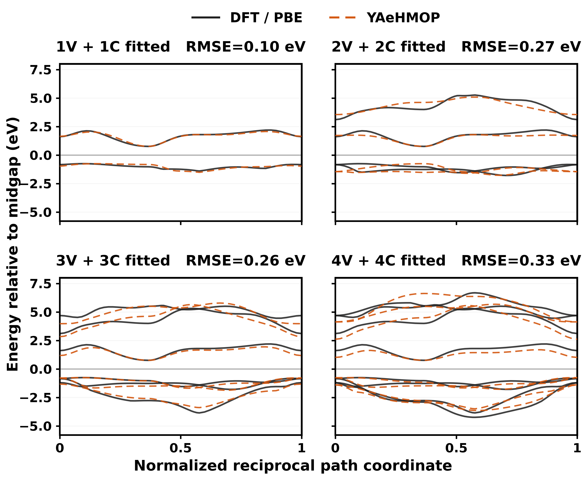
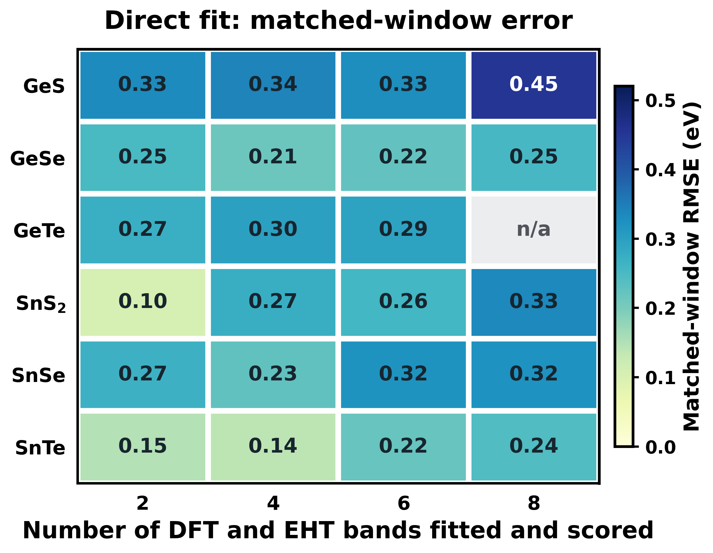
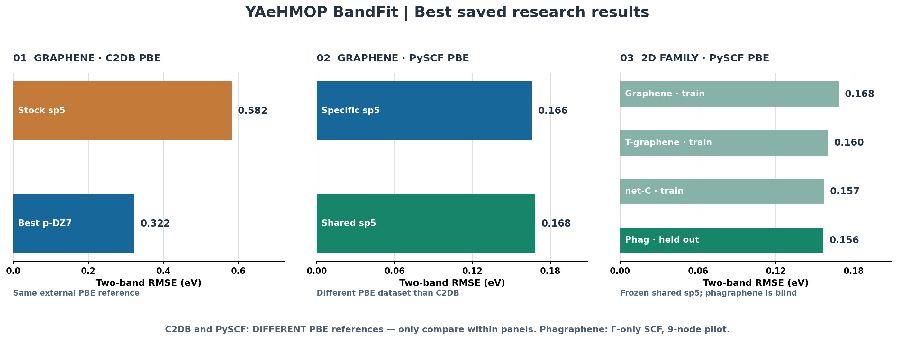

<p align="center"></p>

# YAeHMOP BandFit

**Fit and visualize electronic bands with physical extended Hückel theory — 2, 4, 6 or 8 bands.**

[](https://github.com/tromer-unb/yaehmop-bandfit/actions/workflows/tests.yml)
[**What's new**](#whats-new-november-2026) · [**Graphical interface**](#graphical-interface-band_fit_guipy) · [**Fit YOUR CIF + PNG**](docs/FIT_YOUR_MATERIAL.md) · [**Guia em português**](docs/GUIA_RAPIDO_PT.md) · [Quick examples](#quick-start) · [SnS₂ / paper Fig. 4](#featured-example-sns₂--paper-figure-4) · [Shared transfer](docs/SHARED_FITTING.md) · [All six compounds](docs/CHALCOGENIDES.md) · [Carbon results](docs/BEST_RESULTS.md) · [All CLI flags](docs/CLI_REFERENCE.md)

The **original study** evaluates **six Ge/Sn chalcogenides** — **GeS, GeSe, GeTe, SnS₂, SnSe and SnTe** — with exactly matched **1V+1C, 2V+2C, 3V+3C and 4V+4C** reference/model windows. It also measures chemical leave-one-system-out transferability. **Graphene, phagraphene, diamond and graphite are later carbon extensions**, not the entire scope of this work.

## Quick access: direct versus transfer


**Choose your workflow (tested Python front-end):**
[Installation and three-step guide](docs/START_HERE.md) ·
[Single-material direct fit](docs/FIT_YOUR_MATERIAL.md) ·
[Frozen evaluation on another CIF](docs/START_HERE.md#4-option-b-frozen-transfer-no-refit) ·
[Fit one shared vector to a family](docs/FAMILY_FIT.md) ·
[Ordinary PNG and internal bitplanes](docs/PNG_STANDARD.md) ·
[Português](docs/GUIA_RAPIDO_PT.md).

~~~bash
# 1) Explore instantly, no electronic-structure calculation
python3 quick.py          # tour of the saved best fits: DFT of 5 codes, Fe spin, SOC, WanTiBEXOS files
python3 quick.py paper    # the original study: six Ge/Sn chalcogenides, paper Fig. 4 SnS2, carbon

# 2) Get an explanatory recommendation without any optimization
python USER_WORKFLOW/strategy_advisor.py --cif STRUCTURE.cif --reference BANDS.png   --goal direct --electronic semiconductor --bands auto

# 3) Fit directly (requires YAeHMOP: ./install.sh --build-yaehmop builds the ac-dias/yaehmop fork)
python USER_WORKFLOW/bands_fit.py STRUCTURE.cif SETTINGS.ini --pairs 1 --budget 400 --outdir outputs/source

# 4) Apply that exact vector + K to ANOTHER system, without refitting
python USER_WORKFLOW/frozen_transfer.py TARGET.cif TARGET.ini   --source-run outputs/source/run_summary.json --pairs 1 --outdir outputs/frozen

# 5) Or optimize one shared vector with multiple training CIFs and held-out targets
python USER_WORKFLOW/family_fit.py family.yaml --validate-only
python USER_WORKFLOW/family_fit.py family.yaml --prepare-only --outdir outputs/family
python USER_WORKFLOW/family_fit.py family.yaml --fit --budget 400 --outdir outputs/family
~~~

The last three physical operations require a YAeHMOP `bind` executable, preferably the [ac-dias/yaehmop](https://github.com/ac-dias/yaehmop) fork (`./install.sh --build-yaehmop`), and an atomic parameter table set with YAEHMOP_BIND / YAEHMOP_PARAM_FILE. The example paths are placeholders, not bundled reference bands. **Direct** sees the target in fitting; **frozen evaluation** does not change parameters; **family fitting** excludes a whole held-out target until after the shared fit. These image commands need **gapped, nonmagnetic, spinless** references. Numerical DFT references (`--dft-dir`) also accept spin-polarized runs (`--spin-channel up|down|average`), metals (`objective = metal`), semicore removal (`--semicore auto`) and spin-orbit fits (`soc_fit.py`); see [docs/DFT_REFERENCE.md](docs/DFT_REFERENCE.md). `family_fit.py` accepts every one of these references (DFT folders of any code, gapped and metallic mixed, images, CSV) as members of one shared fit; see [docs/FAMILY_FIT.md](docs/FAMILY_FIT.md). Do not claim Fermi-surface accuracy from a 1D PNG.

## What's new (November 2026)

| Area | What you get | Where |
|---|---|---|
| **Graphical interface** | `python band_fit_gui.py`: every command and option in a desktop window, several fits at once with live progress, figures and metrics; a **family-fit manifest editor** (no YAML to type) | [below](#graphical-interface-band_fit_guipy), [docs/GUI.md](docs/GUI.md) |
| **Raw DFT bands as reference** | `--dft-dir FOLDER --dft-code vasp\|qe\|siesta\|aims\|wannier90`: fits the eigenvalues themselves, with a band-window objective (states near E_F weigh more, gaps, band edges, extrema) | [docs/DFT_REFERENCE.md](docs/DFT_REFERENCE.md), [validation/](validation/README.md) |
| **Metals, spin, SOC** | `objective = metal` (bands aligned at E_F), `--spin-channel up\|down\|average` + `spin_combine.py` (spin-polarized H), `spin_joint_fit.py` (both channels together, common E_F), `soc_fit.py` (on-site λ L·S); `--semicore auto` drops semicore bands | [docs/DFT_REFERENCE.md](docs/DFT_REFERENCE.md) |
| **Hamiltonian export** | every fit writes `fitting/` with the parameters, figures and the EHT H(R), S(R) as text (`huckel-NP.dat`, `huckel-SOC.dat`, `huckel-SP.dat`, WanTiBEXOS format), checked with `wtb.x`; S(k) is kept positive definite during the fit so the export always works | [manual](manual/manual.pdf) §5.4 |
| **Family fits** | one table for several systems mixing DFT folders of any code (gapped and metallic), pictures and CSV, train/test roles, per-member weights, overlap radius and objective weights, `--evaluate` of an earlier fit | [docs/FAMILY_FIT.md](docs/FAMILY_FIT.md) |
| **Speed** | `--overlap-radius auto` (smallest converged lattice sum per system), **parallel populations** (`--parallel`) and `--optimizer alternating` (fast numpy stages where only Hii and K move, with S(k) cached): anatase TiS₂, one evaluation 1.1 s → 64 ms (13 ms in the fast stages) | [docs/CLI_REFERENCE.md](docs/CLI_REFERENCE.md#optimizers) |
| **Optimizers** | DE, CMA-ES, GA, Bayesian, Powell, alternating, each with optional Nelder–Mead/Powell polish, besides the staged default | [docs/CLI_REFERENCE.md](docs/CLI_REFERENCE.md#optimizers) |
| **Larger basis** | `--basis-add "S:d"`, `--basis-dz "S:p"` (double-zeta shells), `--start-from` an earlier fit | [docs/DFT_REFERENCE.md](docs/DFT_REFERENCE.md) |
| **Structure formats** | CIF, VASP, Quantum ESPRESSO, SIESTA, FHI-aims, detected automatically | [docs/STRUCTURE_FORMATS.md](docs/STRUCTURE_FORMATS.md) |
| **Native SOC/spin of the fork** | with the [ac-dias/yaehmop](https://github.com/ac-dias/yaehmop) `bind`, `soc_fit.py` checks its λ's with `bind --soc` `spin_combine.py` runs both channels with `--parm-up/--parm-down --common-fermi` (common E_F, moment), and `spin_joint_fit.py` fits both channels together with that native run (one energy zero; bcc Fe moment = PBE) | [docs/CLI_REFERENCE.md](docs/CLI_REFERENCE.md) |
| **Installation** | `./install.sh` creates the conda environment `yaehmop-bandfit` (with PySide6 for the GUI); `--build-yaehmop` compiles the fork | [docs/INSTALLATION.md](docs/INSTALLATION.md) |

The full user manual (PDF, 32 pages) is [manual/manual.pdf](manual/manual.pdf). Earlier states of the code are tagged (`v2026.11.22`, `main-before-adias-dev`).

## YAeHMOP solver: the ac-dias/yaehmop fork

> **YAeHMOP solver: use our fork [ac-dias/yaehmop](https://github.com/ac-dias/yaehmop) for fitting.**
> `./install.sh --build-yaehmop` compiles it and stores it in the conda environment. The fork is the
> original YAeHMOP plus **double-zeta p orbitals** (required by `--basis-dz X:p`, e.g. interlayer
> coupling in layered materials), **spin-polarized runs**, **spin–orbit coupling**, a configurable K of the
> diagonal term and bug fixes; every change is documented in its
> [`tex/advances_in_yaehmop.pdf`](https://github.com/ac-dias/yaehmop/blob/master/tex/advances_in_yaehmop.pdf).
> With single-zeta tables it gives exactly the bands of the original program (|ΔE| = 0), so results
> obtained with upstream YAeHMOP stay valid. Upstream [greglandrum/yaehmop](https://github.com/greglandrum/yaehmop)
> silently ignores a second p exponent; BandFit detects this and stops instead of fitting nonsense.

## Graphical interface (`band_fit_gui.py`)

```bash
./install.sh                      # once: conda environment yaehmop-bandfit (PySide6 included)
conda activate yaehmop-bandfit
python band_fit_gui.py
```

A desktop window (Qt, no web browser) that runs the same command-line tools, so every option of the
terminal is there and every run can be repeated in a script (*Show command*). Without the conda
environment: `pip install PySide6-Essentials`. The YAeHMOP `bind` comes from `YAEHMOP_BIND` (set by the
environment) or from *File → YAeHMOP executable and parameters*.



*Above: MoS₂ monolayer fitted from an ordinary picture of its PBE bands ([examples/gui_mos2](examples/gui_mos2/README.md)); RMSE 0.074 eV, gap error 0.001 eV, about one minute.*

**Layout.** Left: the list of tasks. Middle: the form of the chosen task. Right: the **Runs** panel
(status, time, calls and best loss of every run; for the selected run its *Log*, the live *Progress*
plot and the *Results*: all figures and the main metrics).

**Fit to a DFT calculation** (task *Fit to DFT*):
1. choose the folder of the band calculation; the package is detected (VASP, QE, SIESTA, FHI-aims,
   Wannier90) and a spin-polarized VASP run is flagged;
2. *Preview* reads the bands without fitting and shows them; if they cross the Fermi level the
   interface offers `objective = metal`;
3. set the run name and output folder; adjust the INI form if needed (energy window, `n_pairs`,
   `budget`, `optimizer`, `basis_add`, `overlap_radius` = `auto`, objective weights) — every field has a
   tooltip and a ▾ list of typical values;
4. *Run fit*. For a spin-polarized run, *Fit both spins* fits up and down at the same time and joins
   them (`huckel-SP.dat`).

**Fit to a picture of the bands** (task *Fit to image*): give the structure (CIF, POSCAR, QE, SIESTA,
FHI-aims) and the picture (PNG/JPEG/TIFF/WebP) or CSV, the energy limits of the plot and the k path
(or pick a *standard path*), *Preview* to check the extracted curves, then *Run fit*. At the end the
fitted EHT bands are drawn over your own picture. Try it with `examples/gui_mos2/` (*Load INI* →
`MoS2_2bands.ini`, structure `MoS2_monolayer.vasp`, picture `MoS2_PBE_2bands.png`).

**Family fit** (one table for several systems): *Add DFT folders…* (several at once) or *Add picture
member…*, set the role (train/test), weight and any per-member key in the table, the shared settings
above it, choose the mode (*Fit*, *Validate only*, *Prepare only*, *Evaluate an earlier fit*) and *Run*.
The manifest is written for you (*Show YAML*, *Save*, *Load…*). Results: the family overview, the
figures of every member and one line of errors per member.



**Other tasks:** *Spin-orbit* (`soc_fit.py`, on top of a spinless fit), *Spin combine*, *Frozen
transfer*, *Compare strategies* (validation protocols) and *Image tools*.

**When a fit ends** a window opens with the comparison against the original data (EHT bands on the
picture, or all DFT and EHT bands) and the main errors; *Open results…* shows any existing `fitting/`
folder. Several fits can run at the same time; each is a separate process. More in [docs/GUI.md](docs/GUI.md)
and in section 3 of the [manual](manual/manual.pdf).

## Quick start

```bash
git clone https://github.com/tromer-unb/yaehmop-bandfit.git
cd yaehmop-bandfit
python3 -m pip install -r requirements.txt
python3 quick.py
```

**That is all you need to see what the code does.** `quick.py` shows, from the saved fits of `validation/`, EHT fits to raw DFT bands of VASP, Quantum ESPRESSO, SIESTA, FHI-aims and Wannier90 (figures and errors), the ferromagnetic Fe fitted with both spin channels together (moment = PBE), the spin–orbit fits and the WanTiBEXOS files every fit writes (`quick.py dft|spin|soc|wtb` for one part). `quick.py paper` shows the original study: saved-band figures, the SnS₂ comparison, six-material summaries, carbon-extension plots and a PNG-to-bands demonstration. Figures go to `outputs/quick/`. **No YAeHMOP solver, DFT calculation, optimizer, network download or huge dataset required.**

## Fit YOUR OWN crystal: CIF + PNG → parameters → all EHT bands

**New user? Start here:** [Complete copy-and-paste tutorial (English)](docs/FIT_YOUR_MATERIAL.md) · [Passo a passo em português](docs/GUIA_RAPIDO_PT.md).

Provide **structure.cif** + **bands.png** (or exact numeric CSV), edit one **file.ini** containing the plot energy limits and **correct reciprocal path**, and run:

> **Raw DFT data as reference:** point the program to the folder of a VASP, Quantum ESPRESSO, SIESTA or FHI-aims band-structure calculation (`--dft-dir FOLDER --dft-code vasp|qe|siesta|aims`) and it fits to the eigenvalues themselves, no image needed. Every fit writes `OUTDIR/fitting/` with the Hückel parameters, the comparison figures (reference blue, EHT red dashed, errors in the figure) and the YAeHMOP Hamiltonian and overlap matrices as plain text (`huckel-NP.dat` in the WanTiBEXOS format, with the position matrix of the basis `huckel-NP_r.dat` for excitons and optics). See [DFT references](docs/DFT_REFERENCE.md) and the examples in [validation/](validation/README.md).

> Instead of a CIF you can give the structure file of **VASP** (POSCAR/CONTCAR/OUTCAR/vasprun.xml), **Quantum ESPRESSO** (pw.x input, any `ibrav`, or output), **SIESTA** (.fdf/.XV/.STRUCT_OUT) or **FHI-aims** (geometry.in/output); the format is detected automatically. See [structure formats](docs/STRUCTURE_FORMATS.md).

~~~bash
# Working directory: cloned repository root
mkdir -p inputs/my_material
cp /your/path/structure.cif inputs/my_material/structure.cif
cp /your/path/bands.png inputs/my_material/bands.png
cp examples/configs/material_2bands_template.ini inputs/my_material/file.ini
# EDIT file.ini: actual emin/emax, reciprocal nodes, labels and band count!

# 1. Extract/check the image (NO solver)
python USER_WORKFLOW/bands_fit.py \
  inputs/my_material/structure.cif inputs/my_material/file.ini \
  --prepare-only --outdir outputs/my_material

# 2. Fit 1 valence + 1 conduction band (runs YOUR installed YAeHMOP)
python USER_WORKFLOW/bands_fit.py \
  inputs/my_material/structure.cif inputs/my_material/file.ini \
  --pairs 1 --budget 400 --outdir outputs/my_material

# 3. Recompute ALL orbital bands using the fitted atomic table and K
python USER_WORKFLOW/bands_fit.py \
  inputs/my_material/structure.cif inputs/my_material/file.ini \
  --from-fit outputs/my_material/fit/fit.json \
  --outdir outputs/my_material_full
~~~

**Before step 2:** install YAeHMOP from the [ac-dias/yaehmop](https://github.com/ac-dias/yaehmop) fork (`./install.sh --build-yaehmop`) or set **YAEHMOP_BIND** and **YAEHMOP_PARAM_FILE** to an existing build of it ([installation](docs/INSTALLATION.md)); inspect **outputs/my_material/reference_prepared/extraction_preview.png** to verify curve extraction. Expected fit outputs: **bands_comparison.png/.pdf/.csv**, **fit/param_best_native.dat**, **fit/fit.json** and **run_summary.json**. The full recomputation creates **bands_full.png/.csv/.npz**.

**PNG pipeline:** [inspect → select visible curves → standardize to bands_N_layers.png → numerical CSV + QA](docs/FIT_YOUR_MATERIAL.md#2-inspect-the-png-and-prepare-the-band-reference-fast-no-solver). PNG/JPEG/TIFF/WebP and CSV are supported; user-reported image axes/paths must match the actual DFT reference. **--image** and **--png** are both valid aliases. Use **--pairs 2/3/4** only if the reference really contains 4/6/8 identifiable bands. Complete [flags](docs/CLI_REFERENCE.md).

**Multi-material?** See [joint family fitting](docs/FAMILY_FIT.md) and [frozen-transfer evaluation](docs/START_HERE.md#4-option-b-frozen-transfer-no-refit). The family_fit.py wrapper standardizes each training material into the same 2/4/6/8-band target used by the physical shared optimizer, and reserves whole test materials until the vector is frozen. Family members may also be DFT folders (gapped, metallic or spin-polarized). The older fit_shared.py expert prototype is separate and uses full-orbital tracing (it now also writes `systems/<name>/fitting/`). The carbon double-zeta patch is experimental. For picture references, ideal gapless graphene, metals and SOC/spin-polarized cases need a numerical DFT reference instead.

## Featured example: SnS₂ — paper Figure 4

**Run only the SnS₂ examples:**

```bash
python3 quick.py sns2
```



**Fig. 4 is the central matched-window demonstration:** it compares original PBE and the corresponding physical YAeHMOP direct-fit bands for the *same number of states* in each panel.

| SnS₂ fit | Selected states | Direct-fit RMSE |
|---|---|---:|
| **2 bands** | **1 valence + 1 conduction** | **0.1043 eV** |
| 4 bands | 2 valence + 2 conduction | 0.2725 eV |
| 6 bands | 3 valence + 3 conduction | 0.2561 eV |
| 8 bands | 4 valence + 4 conduction | 0.3333 eV |

The quick command includes a copy of the **paper's PBE/EHT overlay figure** and generates `SnS2_2_4_6_8_eht.png` from archived, individual physical EHT energy CSVs. External original PBE arrays are **not redistributed**, and nothing is refitted during quick mode.

## Main paper: six chalcogenides, 2/4/6/8 bands

```bash
python3 quick.py materials          # GeS, GeSe, GeTe, SnS2, SnSe, SnTe
python3 quick.py chemical-transfer  # GENUINE leave-one-compound-out results
python3 quick.py SnTe               # An individual material, all fitted windows
python3 quick.py GeSe               # Or GeS, GeTe, SnSe, SnS2
```



| Window | Mean direct-fit RMSE | Materials | Mean zero-shot chemical-transfer RMSE | Eligible holdouts |
|---|---:|---:|---:|---:|
| **2 bands (1V+1C)** | **0.229 eV** | 6 | 0.807 eV | 6 |
| **4 bands (2V+2C)** | **0.248 eV** | 6 | 0.909 eV | 6 |
| **6 bands (3V+3C)** | **0.273 eV** | 6 | 0.704 eV | 6 |
| **8 bands (4V+4C)** | **0.321 eV** | 5 | 3.416 eV | 4 |

For every window, **N selected DFT bands are fitted to N selected YAeHMOP eigenvalues**; these are not post hoc eight-band errors from a two-band fit. The **8-band GeTe** direct fit was not eligible. Whole-compound held-out results are a different task from fitting the material itself, and their errors must not be combined with training errors.

The best individual direct fits across the six materials: **SnS₂** for 2 bands (**0.1043 eV**); **SnTe** for 4 (**0.1391 eV**), 6 (**0.2191 eV**) and 8 (**0.2433 eV**) bands. See [all per-material results and saved numerical bands](docs/CHALCOGENIDES.md).

## Try an individual material immediately

```bash
python3 quick.py GeS
python3 quick.py GeSe
python3 quick.py GeTe
python3 quick.py sns2
python3 quick.py SnSe
python3 quick.py SnTe
```

The repository ships **23 individual fitted physical EHT spectra**, one for each eligible material/window combination, in `examples/chalcogenides/<material>/<2|4|6|8>bands_eht.csv`. The quick command plots them immediately. These are saved **model outputs**, not externally downloaded PBE bands.

## Later extension: carbon allotropes

```bash
python3 quick.py best             # Original Ge/Sn study FIRST, then carbon scores
python3 quick.py graphene         # Best individual C2DB-PBE graphene fit, p-DZ7
python3 quick.py transfer         # Shared graphene sp5 -> held-out phagraphene
python3 quick.py carbon           # Saved EHT graphene, diamond, AB graphite
```



The extended study includes external C2DB graphene PBE (best patched p-DZ7 two-band RMSE **0.3223 eV**, vs stock sp5 **0.5823 eV**); separately generated PySCF/GTH-SZV PBE graphene (specific sp5 **0.1657 eV**, shared sp5 **0.1683 eV**); and blind phagraphene under the same shared sp5 model (**0.1564 eV**, but only 9 k points and Gamma-only SCF). Diamond and AB graphite add 3D tests. **Do not pool different PBE sources or confuse a training fit with transfer.** See [carbon details](docs/BEST_RESULTS.md).

## Your own bands: PNG, JPEG, TIFF, WebP or numerical CSV

```bash
# See the converter immediately: normal color PNG -> native two-band bits
python3 quick.py image

# Preferred: numerical reference energies from CSV
python3 USER_WORKFLOW/prepare_band_png.py examples/synthetic/toy_4bands.csv \
  --n-pairs 2 --emin -3.5 --emax 3.5 --mode csv --outdir outputs/my_input

# Ordinary two-color raster, specifying the actual plot rectangle and colors
python3 USER_WORKFLOW/prepare_band_png.py examples/synthetic/toy_2bands.png \
  --n-pairs 1 --emin -3.5 --emax 3.5 --mode colors \
  --bbox 115,105,1210,820 --colors '#c82d37,#1c7ad5' \
  --outdir outputs/from_image
```

Every accepted raster is normalized to `normalized_source.png`, validated, and converted into the one downstream format: **`bands_N_layers.png`**, an 8-bit grayscale PNG with one bit per selected band. The tool also produces `extraction_preview.png`, numeric extracted curves and QA statistics. It cannot recover physically hidden bands from a screenshot. [Image guide](docs/IMAGE_INPUT.md) · [Numeric bands](docs/NUMERIC_BANDS.md).

## Actually fit a new crystal (optional, runs local YAeHMOP)

To optimize parameters you need a YAeHMOP `bind` executable and atomic table: `./install.sh --build-yaehmop` compiles the fork [ac-dias/yaehmop](https://github.com/ac-dias/yaehmop) (double-zeta p, spin, SOC; same bands as [upstream](https://github.com/greglandrum/yaehmop) for single-zeta tables). No native binary or DFT dataset is bundled.

```bash
export YAEHMOP_BIND=/absolute/path/to/bind
export YAEHMOP_PARAM_FILE=/absolute/path/to/eht_parms.dat

python3 USER_WORKFLOW/bands_fit.py material.cif config.ini \
  --image your_bands.csv --mode csv --pairs 2 \
  --budget 300 --outdir outputs/my_fit
```

`--pairs 1/2/3/4` means exactly `1V+1C / 2V+2C / 3V+3C / 4V+4C`. No solver runs in the Quick Start, CI, or saved-band plotter. The original image-driven fitter assumes a positive gap; graphene's ideal Dirac crossing requires a different carbon-specific objective.

**More:** [Installation](docs/INSTALLATION.md) · [All CLI options](docs/CLI_REFERENCE.md) · [Full example catalog](docs/EXAMPLES.md) · [Scientific limitations](docs/SCIENTIFIC_SCOPE.md) · [Experimental p-DZ7 source patch](experimental/README.md) · [Contributing](CONTRIBUTING.md).

**License:** MIT for this frontend; YAeHMOP (upstream and the ac-dias/yaehmop fork, BSD 2-clause) and external PBE source data retain their own licenses. Saved physical EHT outputs and paper figures are provided for fast research review without third-party raw DFT redistributions.