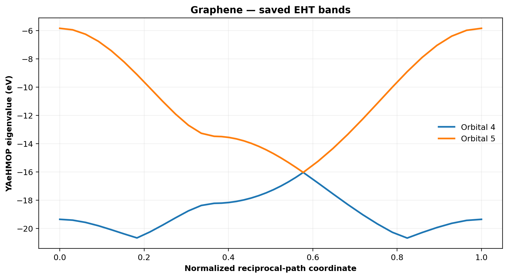
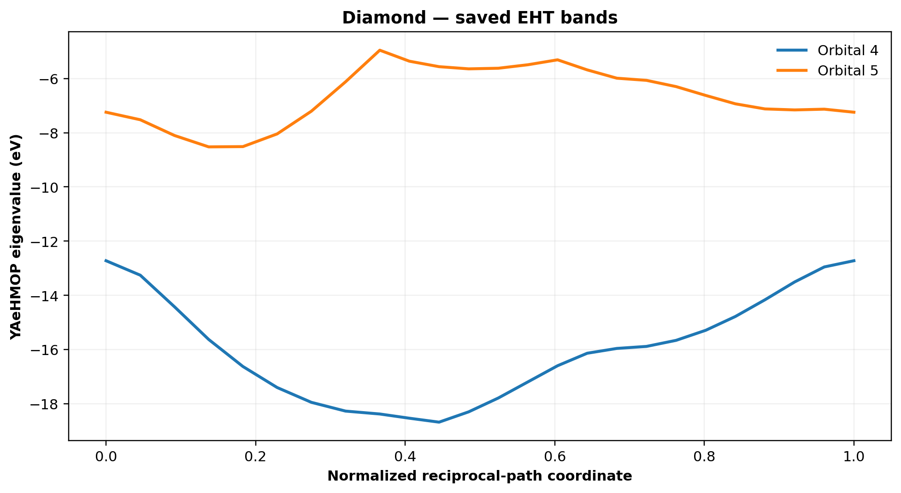
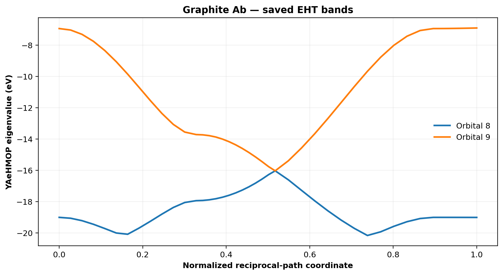

# YAeHMOP BandFit

[](https://github.com/tromer-unb/yaehmop-bandfit/actions/workflows/tests.yml)

**Reproducible extended Hückel band-structure fitting from crystal structures and electronic-band data.**

[Installation](docs/INSTALLATION.md) · [Quick start](#quick-start-no-electronic-structure-calculation) · [Image conversion](docs/IMAGE_INPUT.md) · [Numerical CSV](docs/NUMERIC_BANDS.md) · [All CLI options](docs/CLI_REFERENCE.md) · [Examples](docs/EXAMPLES.md) · [Scientific scope](docs/SCIENTIFIC_SCOPE.md)

YAeHMOP BandFit is a Python workflow around the **original YAeHMOP / `bind` electronic-structure solver**. It helps users turn an electronic-band plot or numerical band table into a documented, machine-readable reference; fit a selected window of valence and conduction states against the physical extended Hückel Hamiltonian; and export band spectra, fitted parameters, diagnostics and reproducible figures.

**No DFT calculations or parameter optimizations run on GitHub.** The included figures and example spectra are already saved. The continuous-integration workflow checks lightweight input/output logic only. Performing a physical YAeHMOP calculation is an explicit, local user action.

> **Scope:** the image-driven fitting protocol primarily targets *gapped semiconductor* curves with 1–4 valence/conduction pairs. Metal/semimetal crossings (e.g. ideal graphene) require a separate gapless objective; examples of graphene, diamond and AB graphite below include saved full-orbital **EHT** spectra and instructions for independently running the original YAeHMOP solver. The program does not claim universal transferability or fully converged DFT results.

## Capabilities

| Feature | What the program actually does |
|---|---|
| CIF input | Reads unit cells and atomic species using ASE. |
| Band target | Accepts **numerical CSV** directly, or decodes PNG, JPEG, BMP, TIFF (safe 8-bit), WebP, GIF (single frame), PPM and other static raster formats Pillow supports. |
| Input normalization | Detects real file format by content, applies EXIF orientation, normalizes supported colors to RGB8, validates pixels and records source/canonical SHA-256 checksums. |
| Exact internal contract | Encodes exactly **2, 4, 6 or 8 selected bands** into an 8-bit layered PNG, with each binary pixel bit representing a different band. |
| Scientific QA | Produces an annotated image, extracted numerical curves, warnings, coverage statistics and encode/decode round-trip error; rejects unsafe/ambiguous input where detectable. |
| Parameter fitting | Uses **actual YAeHMOP eigenvalues**, not an invented surrogate Hamiltonian, when an external compatible solver and atomic parameters are installed. |
| Result inspection | Plots fitted/reference curves, saved full EHT eigenbands, CSV and PDF/PNG, with no new physics required for saved spectra. |
| Paper-associated systems | Includes **graphene (2D), diamond (3D) and AB graphite (3D)** representative CIF examples and archived physical YAeHMOP bands. No third-party DFT reference files are shipped. |

## Installation

Linux/macOS shell (Python 3.10+ recommended):

```bash
git clone https://github.com/tromer-unb/yaehmop-bandfit.git
cd yaehmop-bandfit

python3 -m venv .venv
source .venv/bin/activate
python -m pip install --upgrade pip
python -m pip install -r requirements.txt

python USER_WORKFLOW/bands_fit.py --help
python USER_WORKFLOW/prepare_band_png.py --help
```

Windows PowerShell uses `.venv\Scripts\Activate.ps1` after `py -m venv .venv`. The lightweight preparation, visualization and example tests do **not** need YAeHMOP. For a physical fit, install original YAeHMOP separately: [original upstream](https://github.com/greglandrum/yaehmop) and [installation guide](docs/INSTALLATION.md).

## Quick start: no electronic-structure calculation

The repository supplies **original synthetic** two- and four-band CSV/PNG examples, clearly marked *not DFT*. Start with numerical input (least ambiguous):

```bash
# A. Inspect numeric reference and generate native N-band input PNG:
python USER_WORKFLOW/bands_fit.py \
  examples/structures/graphene.cif examples/configs/synthetic_2bands.ini \
  --mode csv --prepare-only --outdir outputs/toy_csv

# B. Convert a conventional RGB PNG plot into the exact same native contract:
python USER_WORKFLOW/prepare_band_png.py examples/synthetic/toy_2bands.png \
  --n-pairs 1 --emin -3.5 --emax 3.5 \
  --mode colors --bbox 115,105,1210,820 \
  --colors '#c82d37,#1c7ad5' --outdir outputs/toy_png

# C. Validate a color image and its geometry without fitting:
python USER_WORKFLOW/inspect_png.py examples/synthetic/toy_2bands.png \
  --outdir outputs/inspect

# D. Repeat with FOUR selected bands (2 valence + 2 conduction):
python USER_WORKFLOW/bands_fit.py \
  examples/structures/graphene.cif examples/configs/synthetic_4bands.ini \
  --mode csv --prepare-only --outdir outputs/toy_four
```

Look at the resulting `reference_prepared/extraction_preview.png` (or `extraction_preview.png` from the direct converter), `extraction_qa.json`, `extracted_curves.csv` and `bands_2_layers.png` / `bands_4_layers.png`. The command `--prepare-only` **never calls YAeHMOP**.

The graphene CIF here only demonstrates the parser; **toy gapped data are not graphene DFT** and must not be interpreted as such.

<details>
<summary>How is a normal image turned into the special internal PNG?</summary>

```text
User file (.png/.jpg/.bmp/.tiff/.webp/.gif/.ppm or any safe Pillow raster)
          ↓
Format detection by decoded bytes + safety checks, ICC/EXIF/alpha handling
          ↓
normalized_source.png    [RGB8; verified legacy bitplanes stay L8]
raster_ingest_qa.json    [original/canonical hashes + provenance]
          ↓
Curve extraction: selected colors, inspected grayscale, or manual anchors
          ↓
N separate energy curves + coverage/ambiguity diagnostics
          ↓
bands_N_layers.png       [8-bit grayscale, value = sum(1 << band_index)]
          ↓
P5-compatible decoder + numeric interpolation on chosen k-path
          ↓
YAeHMOP solver (ONLY when physical fitting explicitly requested)
```

Crossings are represented by setting more than one bit in the same pixel. This format does **not** turn a raster screenshot into guaranteed correct DFT energies: hidden/overlapping bands remain inaccessible and require reliable original numeric CSV.

See [Image input, color tracing and QA](docs/IMAGE_INPUT.md).

</details>

## Explore saved individual bands from the paper systems

### Examples at a glance

The following panels are **archived original-YAeHMOP EHT** frontier bands (not independently computed DFT). They can be recreated locally using `scripts/plot_saved_bands.py` without installing YAeHMOP.

| Graphene — 2D | Diamond — 3D | AB graphite — 3D |
|:---:|:---:|:---:|
|  |  |  |


No solver, no optimization, no DFT required:

```bash
# Graphene: valence/conduction frontier EHT orbitals
python scripts/plot_saved_bands.py \
  examples/precomputed/graphene/eht_full_bands.csv \
  --orbitals frontier --out outputs/graphene_frontier.pdf

# Diamond: plot all physical original-YAeHMOP orbitals
python scripts/plot_saved_bands.py \
  examples/precomputed/diamond/eht_full_bands.csv \
  --orbitals all --out outputs/diamond_bands.png

# AB graphite: pick two individual orbital indices (1-based)
python scripts/plot_saved_bands.py \
  examples/precomputed/graphite_AB/eht_full_bands.csv \
  --orbitals 8,9 --out outputs/graphite_frontier.pdf
```

The CSVs record previously calculated **physical EHT** eigenvalues on sampled k-paths, not external DFT. Only the originally fitted frontier window was optimized; all other saved EHT orbitals are predictions of that specific fitted parameter table, **not additional fitted reference bands**. See [Examples and provenance](docs/EXAMPLES.md).

### Recompute physical spectra on your own machine (optional)

First install an authorized YAeHMOP `bind` executable and atomic parameter table:

```bash
export YAEHMOP_BIND=/absolute/path/to/yaehmop/bind
export YAEHMOP_PARAM_FILE=/absolute/path/to/eht_parms.dat

# YOUR parameter table must follow the YAeHMOP atomic table format.
python scripts/recompute_carbon.py \
  --system diamond --parameters /absolute/path/to/your_parameters.dat \
  --k 1.75 --overlap-radius 4 --outdir outputs/diamond_physical
```

This **does run the actual local solver** and may take longer than viewing saved data. It does not train a parameter set and does not run on GitHub. The 1D/2D/3D writer creates the appropriate number of periodic lattice vectors and nonzero overlap images along every active direction. See [Local YAeHMOP setup](docs/INSTALLATION.md).

## Run your own fit (optional, potentially expensive)

A user-supplied CIF, numeric bands or visible-band image, and INI settings are required. A YAeHMOP `bind` and parameter table are also required for the actual fit.

```bash
python USER_WORKFLOW/bands_fit.py material.cif config.ini \
  --image bands.csv --mode csv --pairs 2 \
  --budget 300 --optimizer nelder-mead --outdir outputs/fit
```

**The CLI fits and scores the same number of selected states**: `--pairs 1/2/3/4` means exactly `1V+1C / 2V+2C / 3V+3C / 4V+4C`. Although the Hamiltonian diagonalizes the full orbital basis, these are the reference bands used by the objective. Do not interpret a two-band fit as a validated eight-band calculation.

All documented flags: [CLI reference](docs/CLI_REFERENCE.md).

## Repository layout

```text
USER_WORKFLOW/            high-level CLI, raster/CSV ingestion, digitization
parameter_fitter/         original-YAeHMOP objective, solvers, band utilities
source/                   shared source modules for N-band bitplane decoding
scripts/                  toy generator, saved-band plotter, optional local recompute
examples/
  synthetic/              original toy CSV + RGB PNG (not DFT)
  configs/                ready-to-run INI templates for 2/4 bands and carbon
  structures/             graphene, diamond and AB graphite CIFs
  precomputed/            saved physical EHT eigenvalues, per-system metadata/plots
docs/                     setup, image format, CLI, examples, scientific caveats
tests/                    fast CI-safe regressions (NO native physics runs)
.github/workflows/        lightweight syntax and format tests only
```

## Scientific scope, attribution and licensing

An optional, **research-only native 2p double-zeta C patch** is documented in [experimental/README.md](experimental/README.md). It is not applied to stock YAeHMOP, not built by CI, and does not include upstream native sources, binaries or original atomic tables.


This project is a user-facing frontend for **YAeHMOP** and is **not** an upstream YAeHMOP distribution. The upstream engine, its original C sources and atomic parameter tables are **not included**. YAeHMOP is credited to G. A. Landrum and collaborators; please cite the upstream code and relevant papers in downstream publications.

The repository retains the owner's existing **MIT LICENSE** for its own newly distributed material; separate dependencies and original YAeHMOP remain governed by their own licenses. The example synthetic spectra were generated from original toy equations. Precomputed EHT fixtures contain derived results and detailed source metadata; external PySCF/PBE numerical reference spectra are deliberately omitted.

**Limitations:** finite-basis PBE calibration is not basis-converged DFT, and a 9-point phagraphene Gamma-only SCF demonstration is not a validated Dirac-cone result. True 2D-family transferability is a research hypothesis supported by limited pilot holdouts, not a guarantee across 3D sp²/sp³ carbon. See [Scientific scope](docs/SCIENTIFIC_SCOPE.md) and [Citation](CITATION.md).

For issues and improvements, see [CONTRIBUTING.md](CONTRIBUTING.md) and [SECURITY.md](SECURITY.md).
