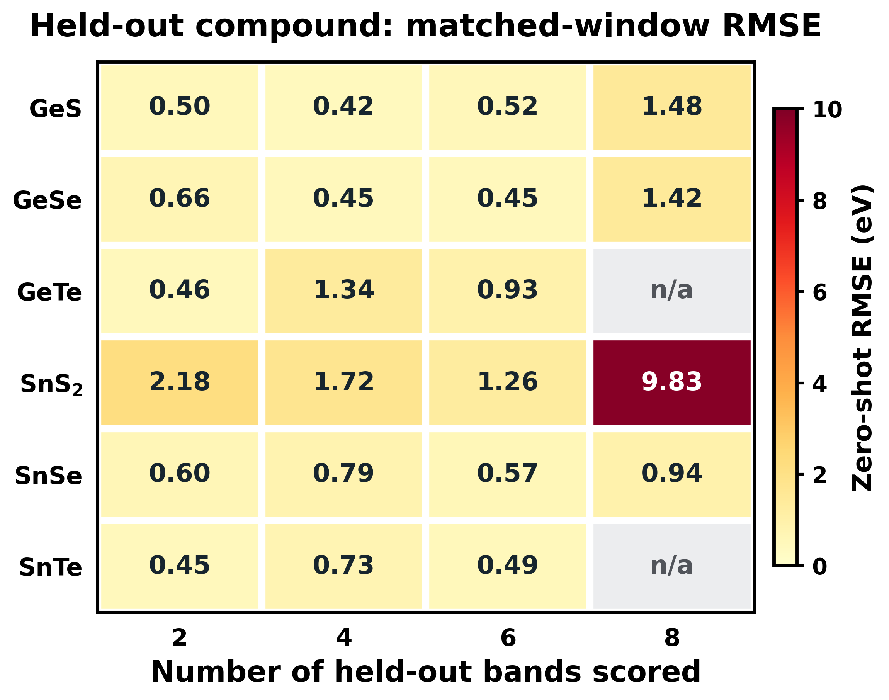

# Original paper: six Ge/Sn chalcogenides and matched 2/4/6/8-band fitting

This is the **main study** and the primary example set for YAeHMOP BandFit. The later carbon program (graphene, phagraphene, graphite and diamond) is documented **separately** in [BEST_RESULTS.md](BEST_RESULTS.md).

## View the paper's central figure immediately

```bash
python3 quick.py sns2
```


This is an image of the original paper comparison (PBE and physical YAeHMOP overlay), **not a new ab initio calculation on GitHub**. Corresponding numeric individual EHT eigenvalues are saved in `examples/chalcogenides/SnS2/{2,4,6,8}bands_eht.csv`, and the quick mode plots those separately as `SnS2_2_4_6_8_eht.png` without requiring any native solver.

| Window | Bands fitted **and** scored | SnS₂ direct-fit RMSE |
|---:|---|---:|
| 2 | 1 valence + 1 conduction | **0.1042584 eV** |
| 4 | 2 valence + 2 conduction | 0.2725024 eV |
| 6 | 3 valence + 3 conduction | 0.2560682 eV |
| 8 | 4 valence + 4 conduction | 0.3332556 eV |

The number N in the headline is the number of **matched reference/model eigenvalues**, not the number of orbitals diagonalized: native YAeHMOP diagonalizes the entire underlying orbital basis. The multi-band fits are not post hoc evaluation of bands that were excluded from a two-band fit.

## Six-material table: mean errors and transfer

```bash
python3 quick.py materials
python3 quick.py chemical-transfer
```

| Band window | Average same-material direct-fit RMSE | Eligible materials | Average whole-compound-held-out RMSE | Eligible folds |
|---|---:|---:|---:|---:|
| 2 | 0.2292777 eV | 6 | 0.8069348 eV | 6 |
| 4 | 0.2481851 eV | 6 | 0.9088251 eV | 6 |
| 6 | 0.2732584 eV | 6 | 0.7038241 eV | 6 |
| 8 | 0.3205818 eV | 5 | 3.4159135 eV | 4 |


**Material-by-material direct-fit RMSE** (eV), using exactly N eigenbands on *both sides*:

| Material | 2 (1V+1C) | 4 (2V+2C) | 6 (3V+3C) | 8 (4V+4C) |
|---|---:|---:|---:|---:|
| **GeS** | 0.3323 | 0.3395 | 0.3282 | 0.4515 |
| **GeSe** | 0.2514 | 0.2138 | 0.2243 | 0.2526 |
| **GeTe** | 0.2716 | 0.2977 | 0.2929 | **N/A** |
| **SnS₂** | **0.1043** | 0.2725 | 0.2561 | 0.3333 |
| **SnSe** | 0.2679 | 0.2265 | 0.3189 | 0.3222 |
| **SnTe** | 0.1482 | **0.1391** | **0.2191** | **0.2433** |

The bold per-window minima identify the strongest fitted-example outcomes **for each individual window**. GeTe has no eligible eight-band trial (missing is *not* zero). Results are calibration errors for materials used in their own fits.

## Numerical band examples for every eligible trial

```bash
python3 quick.py GeS
python3 quick.py GeSe
python3 quick.py GeTe
python3 quick.py sns2
python3 quick.py SnSe
python3 quick.py SnTe
```

All **23 eligible fitted spectra** are provided as small individual CSV files:

```text
examples/chalcogenides/
  benchmark_summary.json        # source provenance and correct fold counts
  direct_and_transfer.csv       # all 6 × 4 result cells, with N/A preserved
  GeS/{2,4,6,8}bands_eht.csv
  GeSe/{2,4,6,8}bands_eht.csv
  GeTe/{2,4,6}bands_eht.csv
  SnS2/{2,4,6,8}bands_eht.csv
  SnSe/{2,4,6,8}bands_eht.csv
  SnTe/{2,4,6,8}bands_eht.csv
```

A `<N>bands_eht.csv` has header `x,EHT_band_1_eV,...,EHT_band_N_eV`. `x` runs from 0 to 1 along the **original P5 k path**; the remaining columns are **already computed physical EHT eigenvalues**. They are not independent DFT/PBE arrays and must not be fed to the main program as though they were experimental reference bands. These are simply fast, inspectable proof that the N-band optimizer produces individual eigencurves, no native solver required.

## Best per-window showcase outcomes

- **2 bands**: SnS₂ **0.1043 eV**.
- **4 bands**: SnTe **0.1391 eV**.
- **6 bands**: SnTe **0.2191 eV**.
- **8 bands**: SnTe **0.2433 eV**.

The original benchmark computed the relevant RMSEs against external Materials Cloud PBE references during physical calibration. The public GitHub archive shares the **derived EHT predictions, paper figures, parameter-fit metrics and provenance**, not the original external PBE numeric arrays.

## Direct fit vs zero-shot transfer are not the same result



`python3 quick.py chemical-transfer` plots errors when a **whole material is excluded from the training set**. These are more stringent than direct fitting; the large 8-band mean reflects difficult outlier folds rather than the direct-fit SnTe RMSE. A second protocol adapting parameters to the target after transfer is not a zero-shot evaluation. Do **not** pool direct-fit and held-out rows.

## Reference and usage cautions

These arrays originated in earlier research conducted on the actual CIFs and original YAeHMOP solver; the research results are **not recomputed during Quick Start**. Recalculation with other atomic bases, K values, CIFs, k paths or solver builds may produce different results. To fit **your own** semiconductor use [installation](INSTALLATION.md), [input formats](IMAGE_INPUT.md), [numeric CSV](NUMERIC_BANDS.md), and [all flags](CLI_REFERENCE.md).

The original article figures are supplied for visual scientific context; users of numerical PBE data must cite the underlying Materials Cloud/C2DB source separately, with its own license/attribution.
