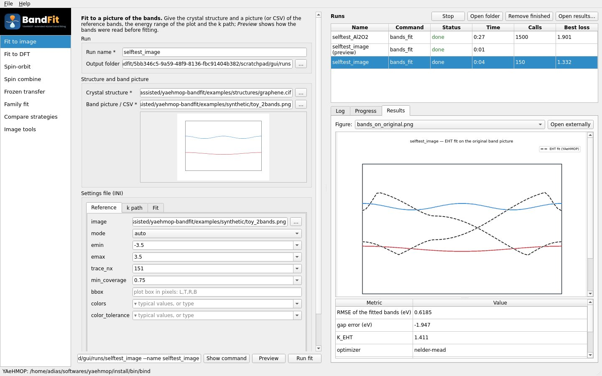
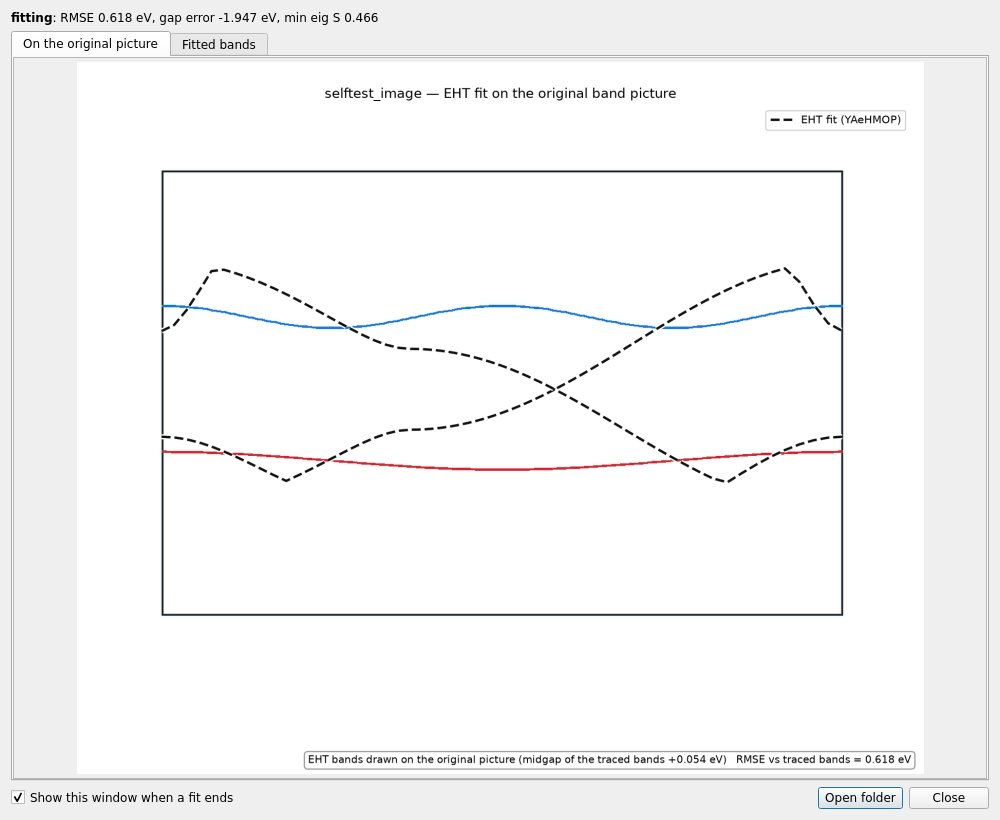

# Graphical interface — `band_fit_gui.py`

A desktop program (Qt, no web browser) for every command of yaehmop-bandfit.

```bash
conda activate yaehmop-bandfit
python band_fit_gui.py
```

It needs PySide6 (`PySide6-Essentials`). `environment.yml` and `install.sh` install it;
otherwise run `pip install PySide6-Essentials`.





## Layout

- **left**: the BandFit logo and the list of tasks;
- **middle**: the form of the chosen task, with *Show command*, *Preview* and *Run* buttons;
- **right**: the **Runs** panel — table of runs (status, time, YAeHMOP calls, best loss) and, for
  the selected run, the *Log*, the live *Progress* plot and the *Results* (every figure of the run
  and the main metrics of `fit_summary.json`).

## Tasks

| Task | Command | What you give |
|---|---|---|
| Fit to image | `bands_fit.py` | crystal structure (CIF, POSCAR, QE, SIESTA, FHI-aims) + picture (PNG/JPEG/TIFF/WebP) or CSV of the bands, energy range, k path (or a *standard path*: 2D hexagonal/square/rectangular, 3D fcc/bcc/simple cubic/hexagonal, 1D). *Preview* = `--prepare-only` (shows `extraction_preview.png`). At the end the fitted EHT bands are drawn over the original picture (`bands_on_original.png`). |
| Fit to DFT | `bands_fit.py --dft-dir` | folder of the band calculation (package detected: VASP, QE, SIESTA, FHI-aims, Wannier90). *Preview* shows the DFT bands; a metal triggers the offer of `objective = metal`. *Fit both spins* fits spin up and down in parallel and runs `spin_combine.py`. |
| Spin-orbit | `soc_fit.py` | DFT run with SOC + `fitting/` folder of a spinless fit |
| Spin combine | `spin_combine.py` | `fitting/` folders of the spin-up and spin-down fits |
| Frozen transfer | `frozen_transfer.py` | fitted parameters + another structure |
| Family fit | `family_fit.py` | YAML manifest |
| Compare strategies | `validation/compare_strategies.py` | protocols on the validation examples |
| Image tools | `prepare_band_png.py`, `inspect_png.py`, `digitize_bands.py`, `strategy_advisor.py` | picture / structure |

## Every command-line option

The forms are built at start-up from each command's own `argparse` definition (read in a
separate process), so **every option of the command line is in the interface**: the main ones on
top, the others in the collapsible *All command-line options* panel, each with its help text as
tooltip. Free-text fields with typical values (budget, `basis_add`, energy window, `band_weights`,
colors, `soc_shells`, overlap radius, …) have a **drop-down list** (▾) of them and stay editable; in
*Fit to DFT* the `dft_file` list holds the band files of the chosen folder, and `--only` of *Compare
strategies* lists the validation examples. A new option added to a command appears automatically. The two fit tasks also have the
INI file as a form (`[reference]`, `[band_path]`, `[fit]`, `[objective]`) with *Load INI*, *Save
INI* and *Show INI*; command-line options override the INI, as in the terminal. *Show command*
prints the equivalent command line, so a run set up in the interface can be repeated in a script.

## Runs

- Each run is a separate process of the command-line tool: several fits can run at the same time
  (one CPU core each).
- Outputs go to `<output folder>/<run name>/` (INI written as `settings.ini`, fit outputs in
  `fitting/`; *Fit both spins*: `spin_up/`, `spin_down/` and `fitting/spin_polarized/`).
- The live loss comes from `fit/progress.csv`, written by the fitter at every YAeHMOP call.
- **When a fit ends, a window opens with the comparison against the original data**: the EHT
  bands on the original picture (picture references), all DFT and EHT bands (DFT references), the
  fitted bands and the main errors; for *Fit both spins* both channels. A check box in that window
  switches it off.
- *Stop* ends the selected run; *Open folder* opens its folder; *Open results…* (also in the
  File menu) shows the figures and metrics of any existing `fitting/` folder.
- *File → YAeHMOP executable and parameters* sets `bind` and `eht_parms.dat` when
  `YAEHMOP_BIND` / `YAEHMOP_PARAM_FILE` are not defined (the conda environment defines them).

## Notes

- Linux: Qt needs the X11/xcb libraries of the system (present on desktop installations).
- The PySide6 wheels carry their own FreeType; the interface imports matplotlib before Qt to avoid a
  library clash with the conda matplotlib.
- Developer check: `BANDFIT_GUI_SELFTEST=/tmp/gui python band_fit_gui.py` (with
  `QT_QPA_PLATFORM=offscreen` on a headless machine) fills the DFT and image tasks with repository
  examples, runs short fits and saves screenshots of every task.
